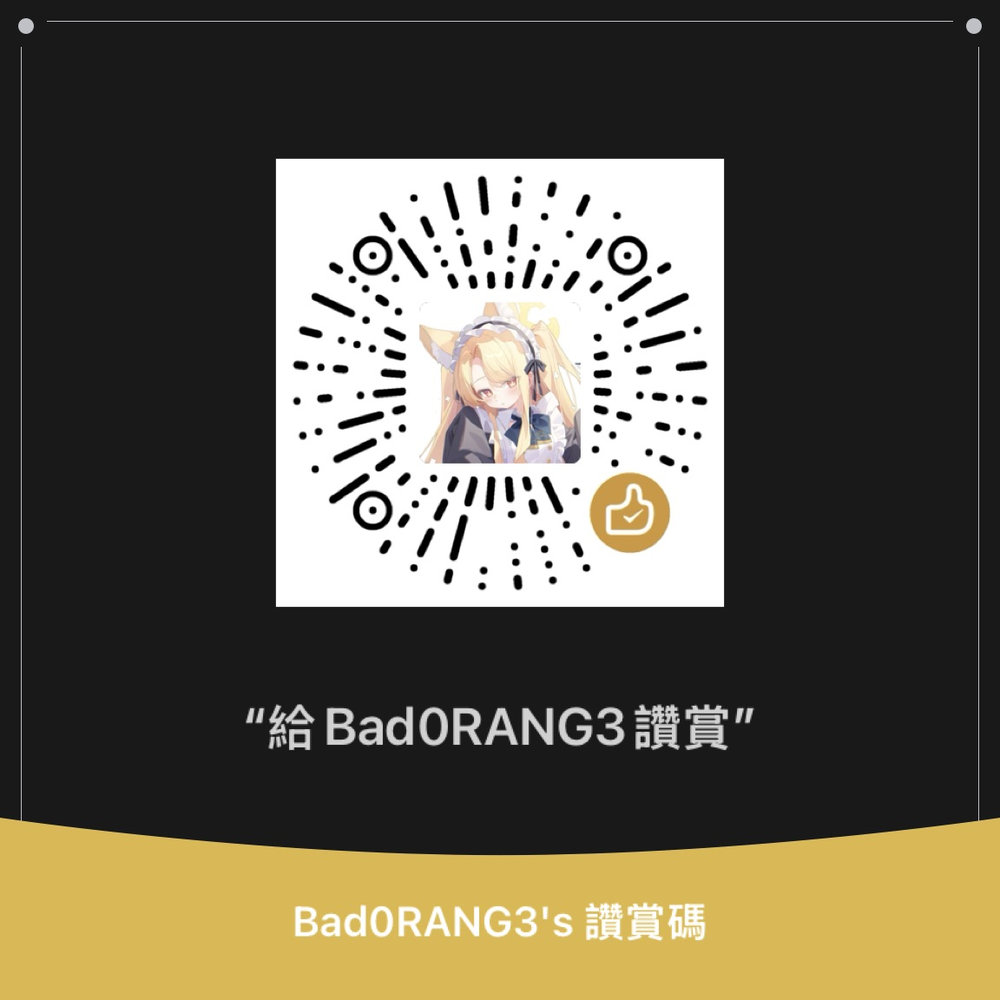

<strong>Build · Break · Make</strong> 
Web · tools · reverse engineering · creative projects

## 01 · About

Hey, I'm **Bad0RANG3**. I like taking things apart to see how they work, then turning whatever idea sticks around into a small, working project. Most of my projects live around the web, scripts, and tools; I also spend time on reverse engineering, packet analysis, and the odd edge case.

## 02 · Toolkit

  

  <strong>Languages</strong> · TypeScript · Python · C++ · Kotlin 
  <strong>Web</strong> · React · Vue · Node.js 
  <strong>Tools</strong> · Git · Docker · Linux · Wireshark 
  <strong>Creative</strong> · FL Studio · After Effects · Photoshop

## 03 · Things I Like

|  |  |
|:--|:--|
| 🛠️ **Build** | Web apps, scripts, small tools, and automation |
| 🔍 **Break** | Reverse engineering, packet analysis, and edge cases |
| 🎮 **Play** | Minecraft, maimai DX, and CS2 |
| 🎛️ **Make** | Music, video, and visuals |

## 04 · GitHub Stats

  
  

## 05 · Setup

| Part | Details |
|:--|:--|
| 🖥️ Desktop | Custom PC |
| 🧠 CPU | AMD Ryzen 7 9800X3D · 8 cores / 16 threads |
| 🎮 GPU | NVIDIA GeForce RTX 4070 Ti SUPER · 16 GB |
| 🔧 Motherboard | MSI B850MPOWER · MS-7E83 |
| 💾 Memory | 32 GB DDR5-6000 · 2 × 16 GB |
| ⚡ Storage | WD Blue SN580 · 2 TB NVMe |
| 🪟 OS | Windows 11 Pro 25H2 · Arch Linux |
| 📱 Phone | iPhone 17 Pro |

## 06 · Find Me

  
  
  
  

  
  
  
  

  
  
  
  

  
  

## 07 · Support

  
   
  If you found something useful here, coffee is appreciated. ♡

